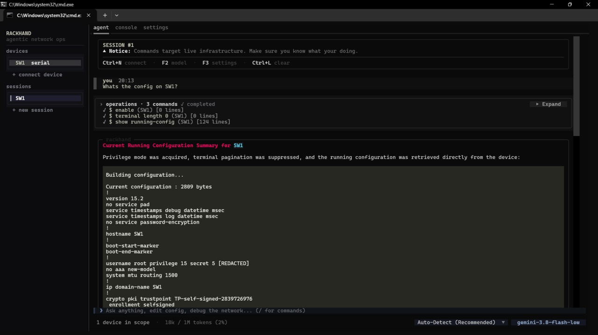

# Rackhand

**Agentic network engineering - autonomously**

Tired of copy-pasting commands back and forth between ChatGPT and PuTTY? Rackhand puts autonomous LLM agents directly on your serial console and SSH sessions. It edits switch and router configs, troubleshoots VLANs and routing protocols, and plans out the exact commands with human approval before touching your hardware.



---

### Download

Grab the standalone Windows executable from **[GitHub Releases](https://github.com/theflorr/rackhand/releases)**.  
No Python installation or dependencies required: download `rackhand.exe` and run it.

---

### What it does

* **Direct Serial & SSH**: Plugs straight into USB-to-serial console cables (with automatic COM port and baud detection) or network SSH sessions.
* **Human-in-the-Loop Safety**: The agent audits and investigates read-only first. If it suggests changes, it presents an approval card with the exact commands and reasoning. You review, edit, or reject before anything gets sent to the CLI.
* **Network Baseline Knowledge**: Pre-loaded with operational playbooks for Cisco (IOS, IOS-XE, IOS-XR, NX-OS, ASA) and Fortinet (FortiOS, FortiSwitch, FortiAP).
* **Multi-Provider AI**: Supports Anthropic Claude, OpenAI, Google Antigravity / Gemini, DeepSeek, OpenRouter, or local Ollama instances.
* **Clean Dark TUI**: Built on Textual with split live console streaming, agent chat, and side-by-side session management.


---

### Running from source

If you prefer running with Python:

```bash
git clone https://github.com/theflorr/rackhand.git
cd rackhand
pip install -e .
python app.py
```

### Compiling

Rackhand compiles into a standalone, single-file `.exe` powered by **PyApp** (Rust + embedded Python 3.12 runtime and uv):

```bash
python compile.py
```

---

### License

Distributed under the [MIT License](LICENSE).
